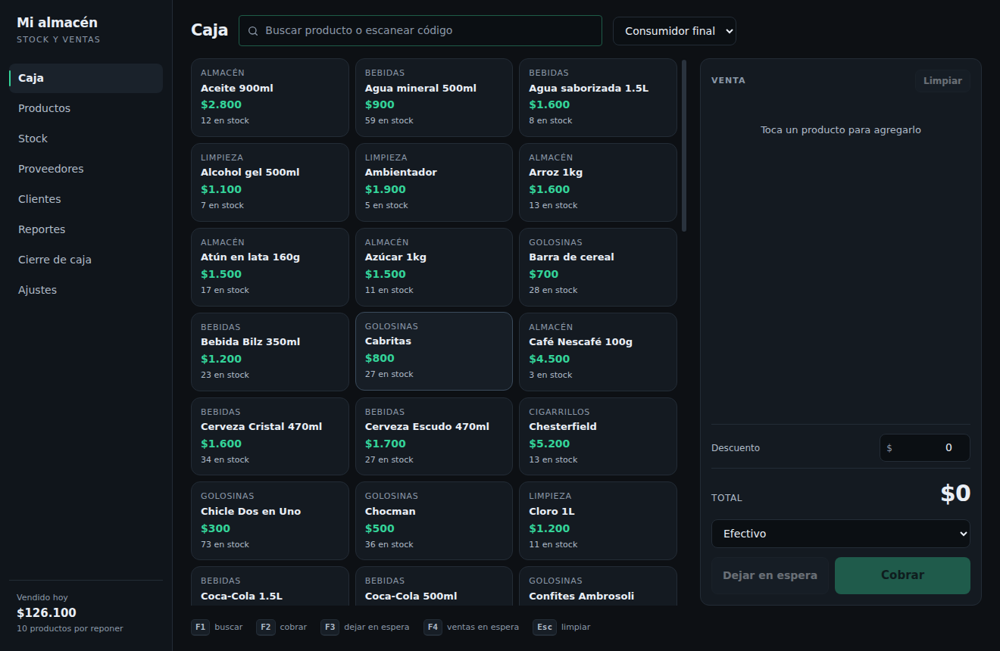
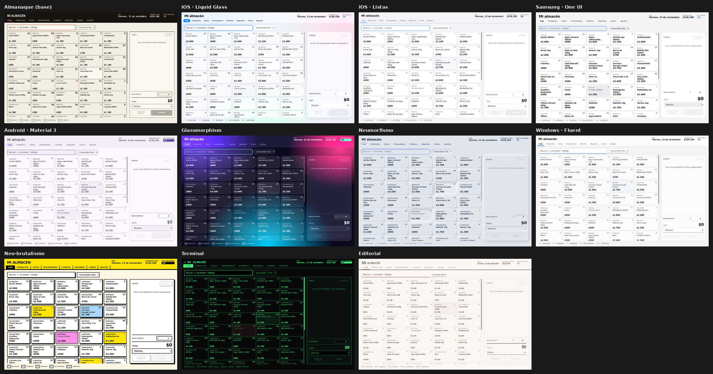
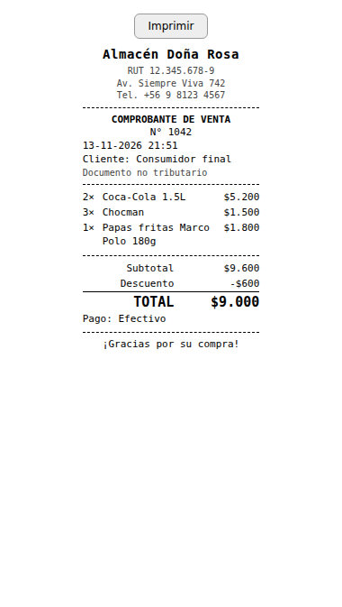
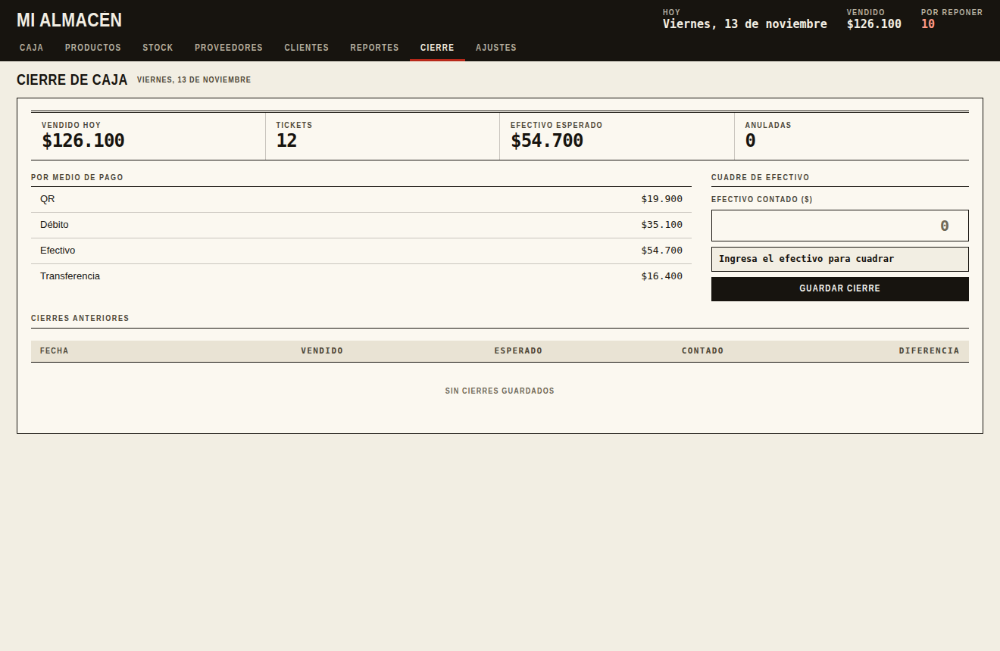
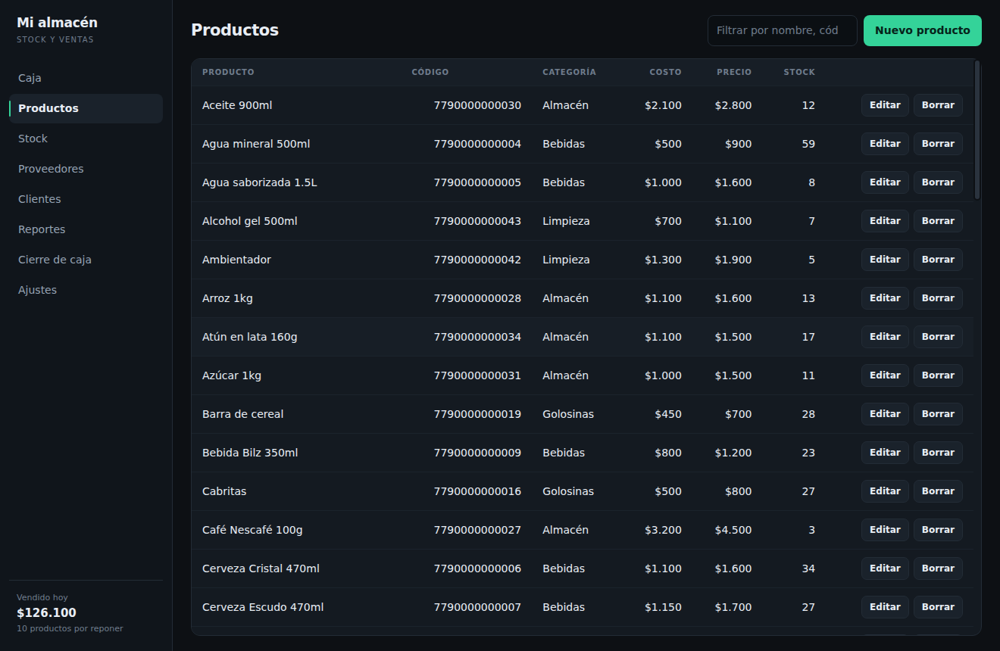
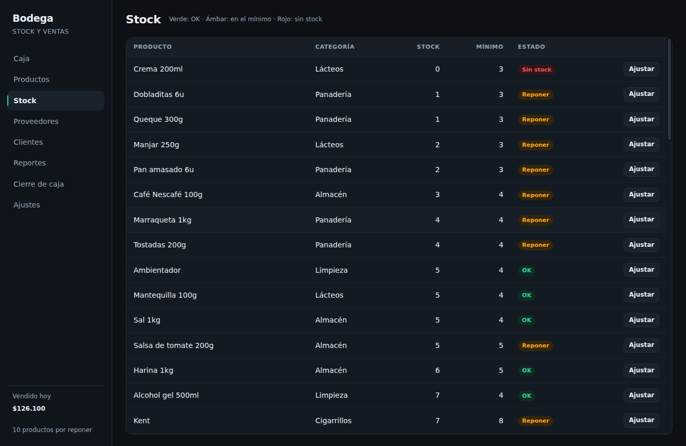

# Bodega

[](https://github.com/blehgk/bodega/actions/workflows/ci.yml)
[](https://github.com/blehgk/bodega/releases/latest)
[](LICENSE)
[](#descargar)

Gestor de stock y ventas para almacenes y kioscos chilenos. Aplicación de escritorio que funciona **sin internet y sin servidor**: los datos viven en la máquina del comercio. Precios en CLP, sin decimales.



## Para quién

Para el almacén de barrio que hoy anota las ventas en un cuaderno o en una planilla: una sola PC en el mostrador, sin conocimientos técnicos, sin instalar una base de datos ni configurar nada. Abre la app y vende.

## Descargar

| Plataforma | Archivo |
|---|---|
| Windows 10/11 (x64) | [`Bodega Setup 0.3.1.exe`](https://github.com/blehgk/bodega/releases/latest) |
| Linux | [`Bodega-0.3.1.AppImage`](https://github.com/blehgk/bodega/releases/latest) |

## Diseño

La interfaz toma el objeto que ya está colgado en la pared de todo almacén: **el almanaque**. Papel de diario, tinta negra y un solo rojo —el de los domingos— para lo que hay que mirar: stock bajo, diferencias de caja, descuentos. Sin tarjetas, sin sombras, sin esquinas redondeadas: reglas y números, como un libro de cuentas. El número de cada celda de producto es su stock.

## Pieles

La interfaz viene en doce pieles intercambiables desde **Ajustes → Apariencia**. Cambian la superficie, nunca la estructura: los mismos datos, el mismo flujo, otro idioma visual.



| Piel | De qué va |
|---|---|
| Almanaque | Papel de diario, tinta y un rojo. La original. |
| iOS · Liquid Glass | Capas translúcidas con desenfoque y bordes de luz. |
| iOS · Listas | Listas agrupadas con separadores de medio píxel. |
| Samsung · One UI | Bloques grandes, radios amplios, aire. |
| Android · Material 3 | Superficies teñidas y elevación. |
| Glassmorphism | Vidrio esmerilado sobre degradado de color. |
| Neumorfismo | Relieve por luz, sin bordes. |
| Windows · Fluent | Mica, radio de 8px, línea de acento. |
| Neo-brutalismo | Borde negro de 3px y sombra dura. |
| Terminal | Fósforo verde, todo monoespaciado. |
| Tinta electrónica | 1 bit: negro puro, grises de trama, cero animación. |
| Editorial | Serif, reglas finas, aire. |

Una piel es un CSS que redefine doce tokens y, si hace falta, algunos componentes. Cómo agregar la tuya: [`src/renderer/temas/README.md`](src/renderer/temas/README.md).

## Qué hace

**Caja**
- Buscar por nombre o escanear con lector de código de barras (sirve cualquiera que emule teclado).
- Carrito con cantidades, descuento en pesos y cliente opcional.
- Cobro por efectivo, débito, crédito, transferencia o QR.
- Ventas en espera: dejar el carrito guardado y recuperarlo cuando el cliente vuelve.
- Comprobante de 58/80 mm con los datos del negocio, listo para imprimir.

**Teclado primero** (el cajero no suelta el escáner)

| Tecla | Acción |
|---|---|
| `Enter` | Agregar el código escaneado o el primer resultado |
| `F1` | Volver a la caja y enfocar el buscador |
| `F2` | Cobrar |
| `F3` | Dejar la venta en espera |
| `F4` | Ver ventas en espera |
| `Esc` | Vaciar el carrito |

**Gestión**
- Productos con código, categoría, costo, precio y stock mínimo.
- **Importación desde CSV**: las 800 fichas de un almacén entran de una vez, con el error de cada fila informado por número de línea.
- **Primera vez**: la app pregunta si querés empezar vacío o con datos de ejemplo, y Ajustes tiene "Empezar de cero" para cuando el ejemplo ya no sirve.
- Stock con alertas de reposición y ajustes con motivo (rotura, vencimiento, conteo).
- Proveedores y compras que reponen stock y actualizan el último costo.
- Clientes con su historial de compras.
- Anulación de ventas: devuelve la mercadería al stock y deja la venta marcada, sin borrar historia.

**Cierre y datos**
- Cierre de caja diario: efectivo esperado contra contado, con la diferencia registrada.
- Reportes: vendido, tickets, unidades, margen, descuentos, anuladas, ventas por día y más vendidos.
- Exportar ventas y productos a CSV para Excel.
- Respaldo y restauración desde Ajustes, más un respaldo automático diario.

## Capturas

| Comprobante | Reportes |
|---|---|
|  |  |

| Cierre de caja | Clientes |
|---|---|
|  |  |

| Productos | Stock |
|---|---|
|  |  |

## Correrlo

```bash
npm install
npm start     # abre la app
npm test      # 17 tests de la capa de datos
```

En Linux dentro de un contenedor sin sandbox configurado: `npx electron . --no-sandbox`.

Para arrancar con datos limpios sin tocar los reales: `npx electron . --user-data-dir=/tmp/bodega-demo`.

### Empaquetar

```bash
npm run dist:win     # instalador NSIS (desde Linux necesita wine)
npm run dist:linux   # AppImage
```

## Arquitectura

Tres capas con una regla: **el renderer no toca Node, el proceso principal no tiene lógica de negocio, y el dominio no sabe que existe Electron.**

```
src/
├── main/                  Proceso principal: ventanas, IPC y archivos
│   ├── index.js           Arranque: datos, demo, respaldo, ventana
│   ├── ventana.js         Ventana principal y ventana del comprobante
│   ├── ipc.js             Registro de canales (única superficie que ve el renderer)
│   ├── archivos.js        Diálogos de CSV y respaldos
│   └── respaldo-diario.js Copia diaria, se conservan 7
│
├── core/                  Dominio puro, sin Electron: se testea con node --test
│   ├── store.js           Fachada: junta los módulos en un solo objeto
│   ├── db.js              Carga, escritura atómica y acceso al estado
│   ├── esquema.js         Forma del archivo y migraciones de versión
│   ├── validar.js         Validación en el borde de confianza
│   ├── productos.js       Catálogo, stock y ajustes
│   ├── ventas.js          Cobrar, anular, ventas en espera
│   ├── clientes.js        Clientes
│   ├── proveedores.js     Proveedores y compras
│   ├── reportes.js        Resumen por rango de fechas
│   ├── caja.js            Cierre y cuadre de efectivo
│   ├── exportar.js        CSV con BOM y separador ;
│   ├── respaldos.js       Respaldo y restauración
│   ├── negocio.js         Datos del comercio (salen en el comprobante)
│   ├── ticket.js          HTML del comprobante 58/80 mm
│   └── seed.js            Datos demo (60 productos, 7 días de ventas)
│
├── preload.js             Puente mínimo: expone window.api y nada más
│
└── renderer/              UI: ES modules nativos, sin bundler
    ├── app.js             Enrutado, atajos y arranque
    ├── index.html         Estructura de las 8 vistas
    ├── styles.css         Tokens + componentes (la piel base)
    ├── temas/             Pieles: un CSS por idioma visual + manifiesto
    ├── ui/
    │   ├── estado.js      Estado de la UI y puente con el main
    │   ├── formato.js     Moneda, fechas y escape (funciones puras)
    │   ├── dom.js         querySelector corto
    │   ├── aviso.js       Toasts
    │   └── modal.js       Diálogo de formularios
    └── vistas/
        ├── caja.js        Buscar, carrito, cobrar, espera
        ├── productos.js   Catálogo
        ├── stock.js       Reposición y ajustes
        ├── proveedores.js Compras
        ├── clientes.js    Clientes
        ├── reportes.js    Números y últimas ventas
        ├── cierre.js      Cuadre de caja
        └── ajustes.js     Negocio, CSV y respaldos
```

### El viaje de una venta

```
caja.js ──bd.vender()──▶ preload.js ──IPC──▶ ipc.js
                                               │
                                        store.vender()
                                               │
                                          ventas.js
                                    (valida stock, descuenta,
                                     guarda venta y movimiento)
                                               │
                                          db.guardar()   ← archivo JSON
                                               │
      ◀──────────── estado completo ───────────┘
  S.datos = estado  →  pintar()
```

Cada mutación devuelve el **estado completo**. El renderer nunca guarda una copia parcial: no hay caché que se desincronice ni eventos que se pierdan.

### Seguridad

- `contextIsolation: true`, `sandbox: true`, `nodeIntegration: false` en todas las ventanas.
- El renderer no tiene `require` ni acceso al sistema de archivos: solo `window.api`, con funciones explícitas.
- Toda validación ocurre en el proceso principal (`core/validar.js`), no en la UI.
- CSP en `index.html`; los enlaces externos se abren en el navegador del sistema, nunca dentro de la app.

## Cómo extender

**Agregar un campo a un producto** (por ejemplo, proveedor habitual):
1. `core/productos.js` → validarlo en `producto()`.
2. `renderer/vistas/productos.js` → agregarlo al formulario y a la tabla.
3. Nada más: si el campo es opcional, el JSON no necesita migración.

**Agregar una vista nueva:**
1. Crear `renderer/vistas/mivista.js` que exporte `pintar()` y `montar()`.
2. Importarla en `renderer/app.js` y sumarla a `VISTAS`.
3. Agregar el `<button data-tab="mivista">` y la `<section id="vista-mivista">` en `index.html`.

**Agregar una operación nueva:**
1. Método en el módulo de dominio (`core/*.js`) que mute el estado y llame a `db.guardar()`.
2. Canal en `main/ipc.js` con `mutar(store, ...)`.
3. Función en `preload.js`.
4. Llamarla desde la vista con `mutar(bd.miOperacion(...))`.

**Cambiar la forma de los datos:** subir `VERSION` en `core/esquema.js` y agregar el paso en `migrar()`. Los datos viejos se migran solos al abrir.

## Cómo se guardan los datos

Un JSON en el directorio de usuario de la app (`~/.config/Bodega/bodega.json` en Linux, `%APPDATA%\Bodega` en Windows):

- **Escritura atómica** (archivo temporal + `rename`): nunca queda un archivo a medias.
- **Archivo corrupto**: se aparta como `bodega.json.corrupto-<fecha>` y la app arranca limpia en lugar de pisarlo.
- **Respaldo automático diario**, se conservan los últimos 7. Además hay respaldo manual.
- **Precios en centavos enteros**: las cuentas no arrastran errores de redondeo.
- **Las ventas guardan nombre, precio y costo del momento**: cambiar un precio no reescribe la historia.
- **El stock solo cambia por venta, anulación, compra o ajuste**, y cada cambio deja un movimiento.
- Los datos de una versión anterior se migran solos al abrir (`v1 → v2`).

## Decisiones de diseño

| Decisión | Por qué |
|---|---|
| JSON en vez de SQLite | Cero dependencias nativas, cero toolchain de compilación en Windows, y con 1.000 productos y 100 ventas/día responde instantáneo. Si algún día hay 200.000 ventas, se migra con un script de importación. |
| Sin bundler ni TypeScript | ES modules nativos que Chromium ya entiende. El proyecto se lee y se edita sin `npm run build`. |
| Estado completo en cada respuesta | Elimina una clase entera de bugs de sincronización a cambio de unos kilobytes por operación. |
| Centavos enteros | `0.1 + 0.2` no es `0.3`. La plata no admite ese error. |
| Comprobante "no tributario" | La boleta electrónica del SII es otro producto: requiere firma electrónica, folios CAF y certificación del contribuyente. Prometerlo sin eso sería mentirle al comerciante. |

## Tests

```bash
npm test
```

17 tests sobre la capa de datos, sin Electron: descuentos, anulación con devolución de stock, ventas en espera, cierre con diferencia, CSV, respaldo/restauración, migración v1 → v2 y el comprobante.

La UI se verifica contra la app corriendo (venta completa, espera, anulación, cierre, comprobante y atajos) antes de cada release.

## Límites

No hace, a propósito: boleta electrónica del SII, multi-usuario con roles, sincronización en la nube, multi-caja en LAN, impresora fiscal. El comprobante que imprime es un documento interno, **no tributario**.

Lo que sí conviene saber antes de confiarle un almacén:

- **Una sola computadora.** El archivo de datos es uno y no se sincroniza. La app impide abrir dos ventanas a la vez porque se pisarían las ventas.
- **El respaldo automático vive en el mismo disco** que los datos. Si el disco muere, se va todo: hay que sacar un respaldo a un pendrive de vez en cuando (Ajustes te dice cuándo fue el último).
- **El instalador no está firmado.** Windows muestra "editor desconocido" la primera vez.
- **No se actualiza sola.** Ajustes muestra la versión y un botón para ver si hay una nueva.
- **Sin usuarios ni contraseñas**: quien abre la computadora ve todo.

Manual para quien atiende el almacén: [`docs/MANUAL.md`](docs/MANUAL.md).

## Contribuir

Los issues y pull requests son bienvenidos. Antes de escribir código, lee [CONTRIBUTING.md](CONTRIBUTING.md): explica dónde va cada cosa, qué reglas sigue el proyecto y qué no se acepta.

Los cambios de cada versión están en [CHANGELOG.md](CHANGELOG.md).

## Licencia

MIT — ver [LICENSE](LICENSE).
