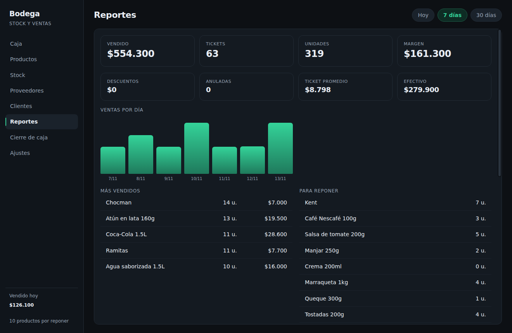
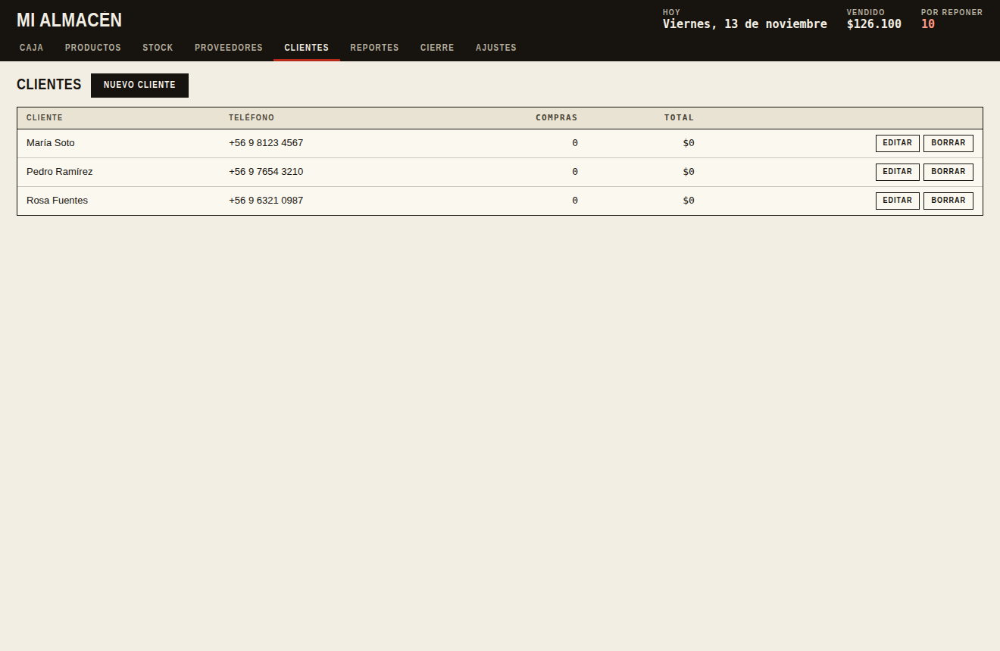

# Bodega

Gestor de stock y ventas para almacenes y kioscos chilenos. App de escritorio que funciona sin internet y sin servidor: los datos viven en la máquina del comercio. Precios en CLP, sin decimales.


## Qué hace

- **Caja** — buscar por nombre o escanear código, carrito, descuento, cliente, cobro por medio de pago.
- **Ventas en espera** — dejar el carrito guardado y recuperarlo cuando el cliente vuelve.
- **Comprobante** — ticket de 58/80 mm con los datos del negocio, listo para imprimir.
- **Anulación** — devuelve la mercadería al stock y deja la venta marcada, sin borrar historia.
- **Cierre de caja** — efectivo esperado vs contado, diferencia y registro diario.
- **Productos** — alta y edición, código de barras, costo, precio y stock mínimo.
- **Stock** — alertas de reposición y ajustes con motivo (rotura, vencimiento, conteo).
- **Proveedores** — compras que reponen stock y actualizan el último costo.
- **Clientes** — nombre, teléfono y su historial de compras.
- **Reportes** — vendido, tickets, unidades, margen, descuentos, anuladas, ventas por día y más vendidos.
- **Datos** — exportar ventas y productos a CSV (Excel), respaldo y restauración en un archivo.
- **Demo incluida** — 60 productos de almacén chileno y 7 días de ventas para que se vea lleno al abrir.

## Capturas

| Comprobante | Reportes |
|---|---|
|  |  |

| Cierre de caja | Clientes |
|---|---|
|  |  |

| Productos | Stock |
|---|---|
|  |  |

## Descargar

Instalador para Windows y AppImage para Linux en [Releases](https://github.com/blehgk/bodega/releases).

## Correrlo

```bash
npm install
npm start     # abre la app
npm test      # 17 tests de la capa de datos
```

En Linux dentro de un contenedor sin sandbox configurado: `npx electron . --no-sandbox`.

Empaquetado: `npm run dist:win` (instalador NSIS) y `npm run dist:linux` (AppImage).

## Cómo se guardan los datos

Un JSON en el directorio de usuario de la app (`~/.config/Bodega/bodega.json` en Linux, `%APPDATA%\Bodega` en Windows):

- Escritura atómica (archivo temporal + rename): nunca queda un archivo a medias.
- Si el archivo está corrupto, se aparta como `bodega.json.corrupto-<fecha>` y la app arranca limpia en lugar de pisarlo.
- Respaldo automático diario, se conservan los últimos 7. Además hay respaldo manual desde Ajustes.
- Los precios se guardan en centavos enteros y se muestran en pesos chilenos sin decimales: las cuentas no arrastran errores de redondeo.
- Las ventas guardan nombre, precio y costo del momento: cambiar un precio no reescribe la historia.
- Los datos de una versión anterior se migran solos al abrir (`v1 → v2`).

## Stack

Electron + HTML/CSS/JS sin bundler. Sin dependencias nativas, sin base de datos, sin build step. El renderer corre con `contextIsolation`, `sandbox` y `nodeIntegration: false`; toda la escritura pasa por IPC validado en el proceso principal.

## Qué no hace (a propósito)

Boleta electrónica del SII, multi-usuario con roles, sincronización en la nube, lector de código de barras físico (funciona cualquiera que emule teclado), impresora fiscal. El comprobante que imprime es un documento interno, no tributario.

## Licencia

MIT — ver [LICENSE](LICENSE).
